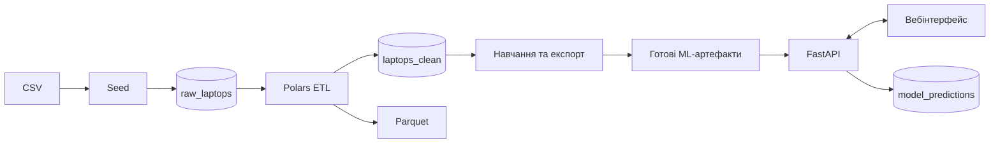

# 💻 Прогноз ціни ноутбука

**PostgreSQL · Polars · scikit-learn · FastAPI · HTML / CSS / JavaScript**

Навчальний вебсервіс, який оцінює ціну ноутбука у **гривнях (UAH)** за його характеристиками, використовуючи моделі ML. Повертає прогноз, типовий діапазон та попередження; показує метрики моделі й аналітичні графіки.

> Повний запуск із власним `.env`, заповненням БД та роботою сайту перевірено користувачем. Для запуску використовується готова ML-модель — повторне навчання не потрібне.

## Можливості

- Форма з актуальними API-довідниками, перевіркою характеристик і підказками біля полів.
- Оцінка ціни моделлю **HistGradientBoosting** та збереження запиту в PostgreSQL.
- Аналітика: тестові метрики, порівняння експериментів, шість графіків і останній прогноз поточної вкладки.
- Український інтерфейс, три теми, контроль анімацій, адаптивність і керування клавіатурою.
- Інтерактивна документація Swagger та Postman-колекція.

## Архітектура



API завантажує модель і довідники з `ml/models/` один раз при старті. Він віддає також HTML і статику — окремий frontend-сервер та збірка не потрібні. Збій БД не блокує прогноз, але історія тоді не зберігається.

## Запуск

Потрібні **Docker Desktop з Compose** та **Python 3.12.6** для локальних seed/ETL. Усі команди виконуються з кореня проєкту в PowerShell.

**1. Налаштуйте середовище.** Якщо `.env` ще немає, створіть його за зразком [.env.example](.env.example) та заповніть `DB_PASSWORD`. Наявний `.env` збережіть.

```powershell
python -m venv venv
.\venv\Scripts\python.exe -m pip install -r requirements-dev.txt
```

За типовими налаштуваннями локальні скрипти підключаються до `localhost:5433`, backend у Docker — до `postgres:5432`.

**2. Створіть і запустіть контейнери.**

```powershell
docker compose --env-file .env --project-name laptop-price-predictor-local up -d --build --wait
docker compose --env-file .env --project-name laptop-price-predictor-local ps
```

Сервіси `postgres` / `backend` створюють контейнери **db_postgres** / **server_backend**. Очікуваний стан обох — `healthy`. Якщо проєкт уже запущений під іншою назвою, використовуйте її надалі: project name визначає volume. Імена контейнерів і порти 5433/8000 мають бути вільні перед першим запуском.

**3. Один раз заповніть нові порожні таблиці.**

```powershell
.\venv\Scripts\python.exe -m db.seed
.\venv\Scripts\python.exe -m etl.etl_main
```

Seed заповнює `raw_laptops`, ETL — `laptops_clean` та `data/processed/feature_set.parquet`. Повторні запуски додають записи; автоматичного очищення немає. Частину `ml/` для звичайного запуску не виконують.

**4. Відкрийте сайт.** Backend уже працює після запуску Compose.

| Сторінка | Адреса за типовими портами |
|---|---|
| Прогноз | [localhost:8000](http://localhost:8000/) |
| Аналітика | [localhost:8000/analytics](http://localhost:8000/analytics) |
| Swagger | [localhost:8000/docs/](http://localhost:8000/docs/) |
| Стан сервісу | [localhost:8000/health](http://localhost:8000/health) |

`init.sql` виконується лише на порожньому volume. Новий пароль у `.env` не змінює пароль уже створеної ролі PostgreSQL. Після звичайної зупинки для повторного запуску достатньо кроку 2 — seed/ETL повторювати не потрібно.

## Модель

Показники збереженої моделі на **244 тестових записах**:

| RMSE | MAE | R² | MAPE |
|---:|---:|---:|---:|
| 11 486 грн | 7 779 грн | 0,868 | 12,80% |

Це якість на історичному датасеті, а не гарантія оцінки конкретного пристрою чи актуальної ціни магазину. Діапазон визначається емпіричними квантилями помилок; стан пристрою та ринкові зміни модель не враховує.

## API та налаштування

| Запит | Призначення |
|---|---|
| `POST /api/predict` | Ціна, межі, модель і попередження |
| `GET /api/options` | Категорії форми та діапазони навчальних даних |
| `GET /api/model-info` | Метрики, CV і тюнінг |
| `GET /health` | `status`, `model_loaded`, `db_ok` |

Контракт: [openapi.yaml](openapi.yaml), `/openapi.json`, `/redoc`. Для перевірки залежностей читайте JSON `/health`: стан `degraded` теж має HTTP 200.

Назва, контакти футера, маршрути й тайм-аут — у [frontend/config.js](frontend/config.js). Тема й рух зберігаються в `localStorage`; останній успішний прогноз — у `sessionStorage` поточної вкладки. Це окремо від серверної історії прогнозів.

## Структура та перевірки

| Тека | Вміст |
|---|---|
| `db/` · `etl/` | SQL-схема, seed, очищення та ознаки |
| `ml/` | Навчання, оцінювання, довідники й готові артефакти |
| `backend/` | API, валідація, модель і запис у БД |
| `frontend/` | Сторінки, стилі, JavaScript і графіки |
| `docs/` · `tests/` | Звіти оцінювання, графіки та backend/API-перевірки |

```powershell
.\venv\Scripts\python.exe -m unittest discover -s tests -v
# Після запуску сервісу:
.\venv\Scripts\python.exe tests/check_collection_http.py
```

[Postman-колекція](postman-collection.json) містить 25 запитів із JS-перевірками. HTTP-helper перевіряє відповіді за OpenAPI, але не виконує Postman JavaScript. Успішні запити додають записи до історії.
